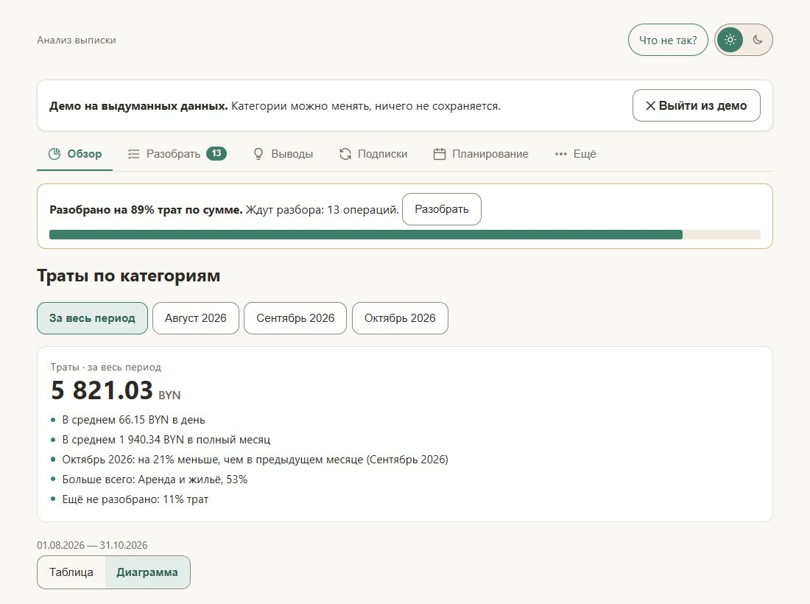
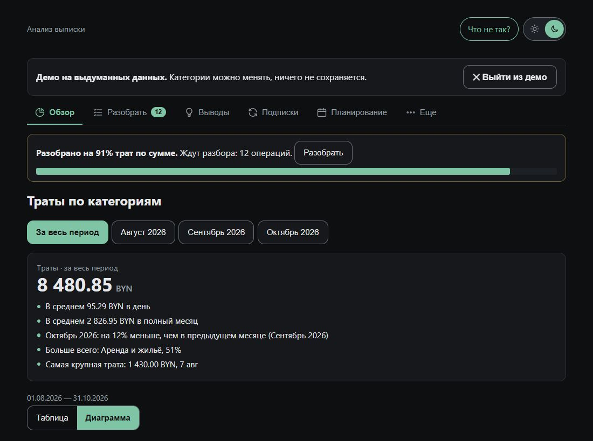
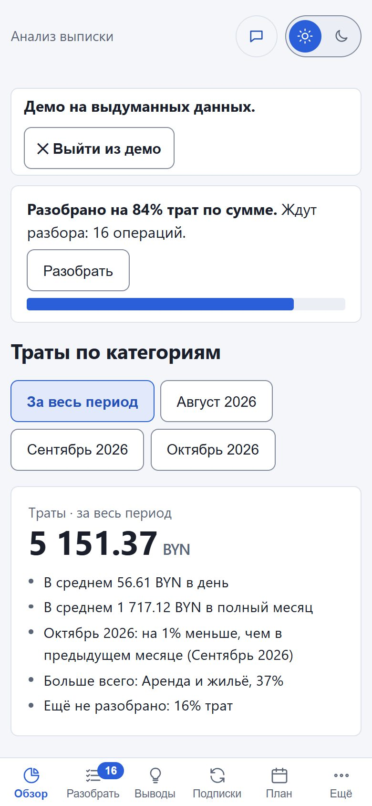
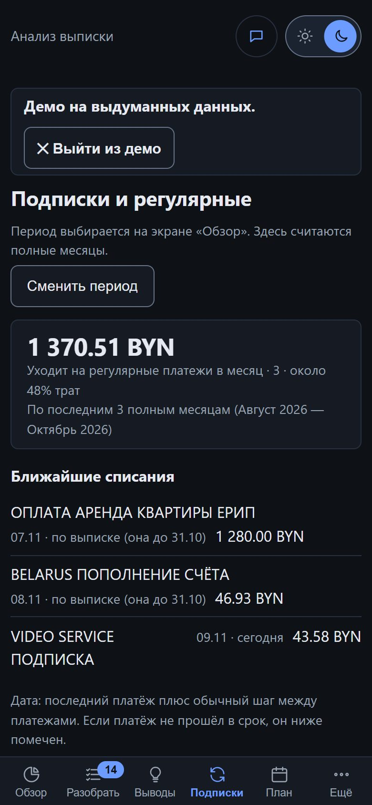

# Анализ банковской выписки

Сайт, который разбирает PDF- и CSV-выписки белорусских банков и показывает, на что уходят деньги: траты по категориям, сравнение месяцев, повторяющиеся платежи, комиссии. **Всё считается в браузере, выписка никуда не отправляется.** Работает без регистрации и без интернета.

<p>
  
  
</p>
<p>
  
  
</p>

*Снимки сделаны в демо-режиме на выдуманных данных.*

Нет живой выписки под рукой? На главной странице есть кнопка демо: все разделы можно посмотреть на выдуманных операциях.

## Что умеет

- Загрузка одной или нескольких выписок сразу, банк определяется автоматически. Повторы операций при пересекающихся периодах пропускаются.
- Сверка с шапкой выписки: если банк указывает итоги поступлений и списаний, сайт сравнивает с ними разобранные операции (до копейки) и показывает ✓ или расхождение.
- Категории по MCC и по тексту операции; операции, которые не удалось определить, собраны в группы для ручного разбора. Выбор запоминается в браузере.
- Подсказки в «Разобрать» (`hints.js`): если группа похожа на перевод человеку, на перевод между своими счетами (приходит и уходит почти поровну) или на вывод с игровой площадки, сайт показывает подсказку. Категорию он сам не назначает, решает человек. В демо есть пример.
- Переводы между своими счетами и платежи вида «пришло и сразу ушло» (например, пополнение карты через ЕРИП) не считаются доходом и расходом, но остаются в списке с пометкой. Переводы между выписками разных банков находятся автоматически.
- Круговая диаграмма и таблица, сравнение месяцев, выводы (крупные траты, месяц к среднему, комиссии). Столбцы «Динамики трат» нажимаются: клик открывает этот месяц.
- «Подписки»: сколько уходит на регулярные платежи в месяц, ближайшие списания, что не прошло в срок.
- «Планирование» и «Цели и бюджеты»: лимиты по категориям, «осталось X, можно тратить Y в день», прогноз к концу месяца.
- Поиск и фильтры в списке всех операций: текст, расходы или поступления, сумма от и до, категория.
- Выгрузка в CSV (операции и итоги по месяцам), сохранение и загрузка разбора файлом, печать или сохранение отчёта в PDF средствами браузера.
- Установка на телефон как приложение (PWA) и работа без интернета.
- Кнопка «Что не так?»: готовое письмо разработчику без данных выписки (только версия, банки, число операций).
- Светлая и тёмная темы, адаптивная вёрстка, управление с клавиатуры.

## Поддерживаемые банки

| Банк | Формат | Сверка итогов |
| --- | --- | --- |
| БПС-Сбербанк | выписка по счёту (PDF) | да |
| Альфа-Банк | выписка по кредиту и кредитной карте, выписка по карте (PDF) | да |
| МТБанк | выписка по карт-счёту (PDF) | да |
| ВТБ (Беларусь) | выписка по счёту (PDF, альбомная) | да |
| Беларусбанк | выписка по счёту (PDF) | да |
| Приорбанк | выписка по контракту (PDF и CSV) | да |

Новые банки добавляются по мере появления образцов выписок. Для каждого банка нужен свой парсер: форматы PDF у банков разные.

## Приватность и безопасность

- Файл читается в браузере, на сервер ничего не загружается.
- Библиотека pdf.js встроена в страницу, ничего с чужих серверов не подгружается.
- Политика CSP в самой странице запрещает любые сетевые запросы (`connect-src 'none'`), внешние картинки и скрипты; встроенные скрипты разрешены только по хэшу (его считает `build.py`).
- В `localStorage` хранятся только правила категорий, свои категории и значки, тема и вид, а также выбор категории для отдельных операций (ключ: дата, время, сумма, остаток). Сами выписки не сохраняются.
- Установка на телефон и офлайн (PWA): на странице по https работает `sw.js`, он кэширует только файлы самого приложения (страница, манифест, иконки) с того же адреса. Выписки и данные в кэш не попадают. Установка: Android Chrome, меню «Установить приложение»; iPhone, Safari, «Поделиться» → «На экран Домой». Скачанный файл с диска открывается как раньше, без установки.
- Файл разбора содержит реальные операции: храните его у себя.
- CSP защищает от подмены внешних скриптов, но не от того, кто правит сам файл сайта. Для этого нужны двухфакторная защита хостинга, защита основной ветки и открытый код.

## Устройство

Чистые HTML, CSS и JavaScript, без сборщиков и зависимостей на этапе работы.

| Файл | Назначение |
| --- | --- |
| `src/analyzer.html` | страница, интерфейс, логика отчёта |
| `src/parser.js` | разбор выписки МТБанка |
| `src/vtb.js` | разбор выписки ВТБ (поворот страницы, знаки по цепочке остатков) |
| `src/belarusbank.js` | разбор выписки Беларусбанка |
| `src/prior.js` | разбор PDF-выписки Приорбанка |
| `src/priorcsv.js` | разбор CSV-выписки Приорбанка (windows-1251, категории банка) |
| `src/planner.js` | планирование: регулярные платежи, прогноз, бюджеты, накопления |
| `src/backup.js` | проверка и очистка файла разбора при загрузке |
| `src/banks.js` | реестр банков и автоопределение |
| `src/categories.js` | категории, MCC, правила, ЕРИП |
| `src/transfers.js` | пары «пришло и сразу ушло» внутри выписки |
| `src/merge.js` | несколько выписок, повторы, переводы между банками |
| `src/export.js` | CSV |
| `src/filters.js` | поиск и фильтры в списке «Все операции»: текст, расходы/поступления, сумма, категория |
| `src/feedback.js` | кнопка «Что не так?»: сборка письма без данных выписки |
| `src/pwa.js`, `src/sw.js`, `src/pwa/` | установка на телефон и офлайн: регистрация, service worker, манифест, иконки |
| `src/demo.js` | демо на выдуманных данных |
| `src/vendor/` | pdf.js (Apache 2.0) |
| `src/build.py` | сборка одного файла `bank-analyzer.html`, CSP |

Банк это плагин: поля `id`, `name`, `detect(pages)`, `parse(pages)`, `validate(txs, header)`. Чтобы добавить банк, нужно написать файл разбора и добавить его в список `BANKS` в `banks.js`.

## Сборка и тесты

```
cd src
python3 build.py                 # собирает ../bank-analyzer.html
for t in tests/test_*.js; do node $t; done   # каждый должен напечатать «Все проверки пройдены.»
```

Проверка вёрстки в браузере (нужен Microsoft Edge и Node 22+, пакеты не ставятся): раздайте собранный сайт локально и запустите аудит.

```
python3 -m http.server 8765 --directory docs   # из корня репозитория, в отдельном окне
cd src && node tests/ui_audit.mjs              # или: node tests/ui_audit.mjs http://localhost:8765/ --quick
```

Аудит открывает главную, все вкладки демо, все окна, шаги 2–4 мастера образца и ошибки загрузки (на выдуманных файлах), «Все операции» с поиском, «Свою категорию» и печать на 320/390/768/1280 px в светлой и тёмной теме и печатает только нарушения: зоны нажатия (на телефоне меньше 44 px, на ПК меньше 32 px), контраст текста ниже 4,5:1 (крупный ниже 3:1), страница шире экрана, Tab и Shift+Tab не ходят по кругу внутри окна. В конце строка «Итог», код возврата 1 при нарушениях. С `--shots <папка>` сохраняет снимки этих сценариев.

Тесты используют только выдуманные данные. Настоящие выписки в репозиторий не входят и не должны попадать в тесты, код и файлы разбора.

## Ограничения

- PDF из интернет-банка (у Приорбанка ещё и CSV). Сканы, фотографии, Excel и Word не читаются.
- Банков пока четыре. Выписка неподдерживаемого банка честно отклоняется.
- Нет синхронизации между устройствами и подключения к банку: это сознательный выбор ради приватности.
- Категории определяются правилами и могут ошибаться: любую можно поправить вручную.

## Сторонние компоненты

[pdf.js](https://github.com/mozilla/pdf.js) от Mozilla, лицензия Apache 2.0 (`src/vendor/pdfjs-LICENSE.txt`).

## Как участвовать

Нужен ваш банк? Откройте issue и опишите, какой банк и в каком формате выписка. Выписку не прикладывайте: в ней личные данные. Чтобы добавить разбор, достаточно структуры файла (названия колонок, порядок) и выдуманного примера.

## Лицензия

MIT, см. `LICENSE`.
